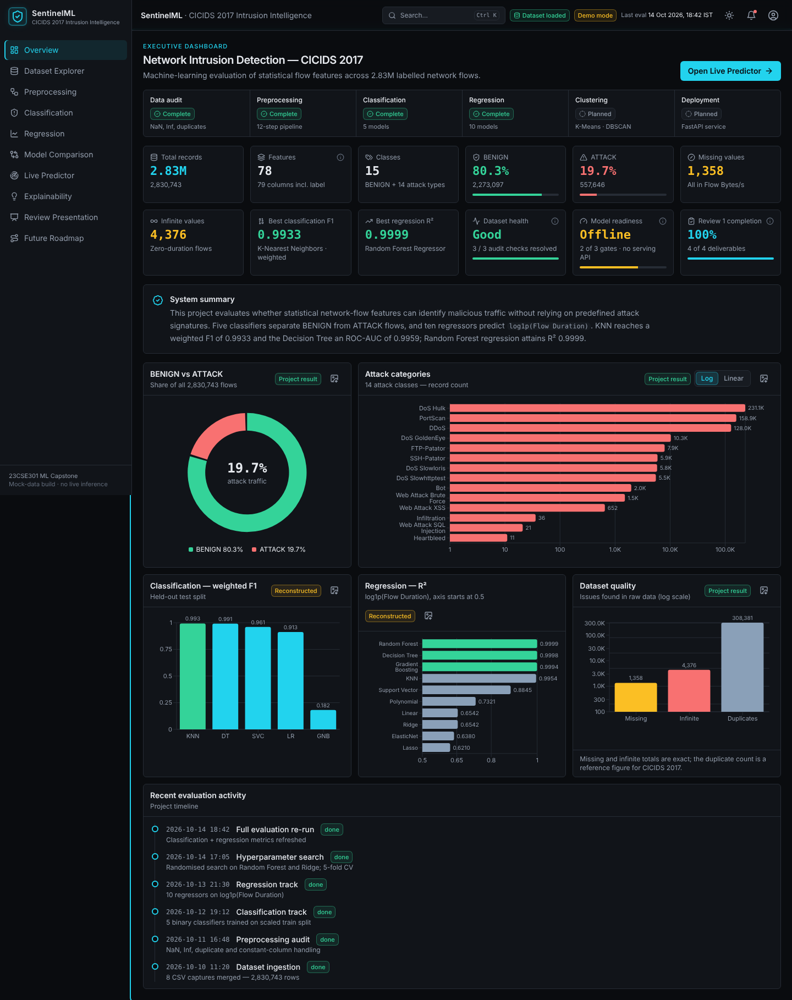

# SentinelML — CICIDS 2017 Intrusion Intelligence

A React + TypeScript + Vite + Tailwind analytics console for the **Machine Learning-Based Network Intrusion Detection (CICIDS 2017)** capstone. It presents the dataset, preprocessing pipeline, 5 classifiers, 10 regressors, comparisons, explainability, an evaluator presentation mode and a roadmap — plus a Live Predictor with a swappable API layer.

> **Honesty note.** The site runs on structured mock data. Headline numbers you supplied are used exactly; plots such as confusion matrices, ROC curves and residuals are **reconstructed** from those metrics. Live Predictor output comes from a rule-based demo scorer and is always labelled **SIMULATED** unless a backend is connected. Every figure carries a provenance badge (Project result / Repo README / Reconstructed / Illustrative).



## Quick start

```bash
cd sentinelml-web
npm install
npm run dev            # http://localhost:5173
npm run build          # production build → dist/
npm run build:streamlit  # single-file bundle → streamlit_bundle/index.html
```

Node 18+ required. This folder is self-contained — nothing outside it was modified.

## Deploy on Streamlit Community Cloud

Streamlit cannot run a React app natively, so `streamlit_app.py` embeds the pre-built **single-file** bundle (`streamlit_bundle/index.html`, ~850 KB, all JS/CSS inlined) with `st.iframe` (falls back to `components.html` on older Streamlit).

1. Make sure `streamlit_bundle/index.html` is committed (it is not named `dist/`, which your root `.gitignore` excludes).
2. On [share.streamlit.io](https://share.streamlit.io) → **New app** → pick the repo and branch.
3. **Main file path:** `sentinelml-web/streamlit_app.py`
4. Deploy. Dependencies come from `sentinelml-web/requirements.txt` (just `streamlit`). Your repo’s root `streamlit_app.py` and `requirements.txt` are untouched, so the existing NetShield app can still be deployed separately.

Test locally: `pip install streamlit && streamlit run streamlit_app.py`. Add `?h=1200` to the URL to change the embedded viewport height. After editing the UI, re-run `npm run build:streamlit` and commit the new bundle. (Inside Streamlit the app automatically switches from hash routing to in-memory routing because the iframe is `about:srcdoc`.)

## Pages

| Route | Page | Highlights |
|---|---|---|
| `/` | Overview | 12 KPI cards, pipeline status panel, donut, attack bars (log/linear), F1 and R² charts, data-quality chart, activity timeline |
| `/dataset` | Dataset Explorer | Searchable/sortable class table, category filter, count/%/log chart, missing & infinite tables, duplicate summary, 8-file table with per-file class mix, 78-feature explorer |
| `/preprocessing` | Preprocessing | 12 clickable steps → purpose / input / output / why / risks / leakage, before-after stats, leakage callout |
| `/classification` | Classification | 5 model cards, sort & filter, F1 bars, ROC, precision-recall, FN/FP, radar, confusion matrix, report, explanation |
| `/regression` | Regression | 10 models, R²/RMSE/MAE, predicted-vs-actual, residuals, CV, tree importances, “why trees won” |
| `/clustering` | Clustering | K-Means + Agglomerative (k=3, silhouette 0.9946), elbow, PCA/t-SNE, linkage comparison, cross-tab, simulated assignment demo |
| `/comparison` | Model Comparison | Task toggle, metric selector, sort, best-highlight, compare ≤3, **CSV export**, **PNG export**, recommendations |
| `/predictor` | Live Predictor | 18 validated inputs, presets, classifier/regressor selectors, loading / error / empty states, result with confidence, risk, contributions |
| `/explainability` | Explainability | Global/classification/regression importance, positive & negative predictors, per-flow explanation |
| `/presentation` | Review Presentation | 10 slides, Present overlay, browser fullscreen, prev/next, progress, speaker notes (N), arrow keys |
| `/roadmap` | Future Roadmap | 15 items with Completed / In progress / Planned, filters, expandable details |

Shell: fixed sidebar (drawer on mobile), header with dataset status, demo/API badge, last-evaluation time, theme toggle, notifications and profile menu, **Ctrl/⌘+K search**, `?` shortcuts, `G` then `1–0` page jumps, skip link, focus-visible rings, tooltips, toasts, modals, skeleton/empty/error states.

## Project structure

```
sentinelml-web/
├── streamlit_app.py            # Streamlit entrypoint (embeds the bundle)
├── streamlit_bundle/index.html # single-file production build for Streamlit
├── requirements.txt            # streamlit
├── src/
│   ├── data/                   # ALL mock data lives here (no big arrays in components)
│   │   ├── dataset.ts          # stats, class counts, per-file counts, quality, activity
│   │   ├── features.ts         # 78 features (30 with real stats from feature_metadata.json)
│   │   ├── classification.ts   # metrics, reconstructed confusion matrices & ROC, model notes
│   │   ├── regression.ts       # 10 regressors, reconstructed scatter/residuals
│   │   ├── importance.ts  pipeline.ts  roadmap.ts  samples.ts  presentation.ts
│   ├── api/
│   │   ├── client.ts           # mock ↔ real backend switch (VITE_API_URL)
│   │   ├── mockEngine.ts       # rule-based demo scorer (NOT the trained model)
│   │   └── types.ts            # request/response contract
│   ├── components/             # Sidebar, TopHeader, MetricCard, ChartPanel, DataTable, ModelCard,
│   │                           # ConfusionMatrix, PipelineStep, PredictionForm, PredictionResult,
│   │                           # FeatureImportanceChart, StatusBadge, ui/{Tooltip,Modal,Toast,States,…}
│   ├── pages/                  # one file per route
│   └── hooks/ lib/             # theme, session state, CSV/PNG export, formatting
└── docs/screenshots/
```

## Connecting a FastAPI backend

Set the base URL and rebuild (or use `npm run dev`):

```bash
echo "VITE_API_URL=http://localhost:8000" > .env.local
```

When set, the Live Predictor calls two endpoints and the SIMULATED badges disappear. Feature keys are the CICIDS column names (e.g. `"Flow IAT Max"`).

```
POST /api/predict/classification
{ "model": "knn", "features": { "Destination Port": 80, "Flow Duration": 1878, ... } }
→ { "label": "ATTACK" | "BENIGN", "attackProbability": 0.97, "confidence": 0.97,
    "risk": "Low|Medium|High|Critical",
    "contributions": [ { "feature": "Packet Length Variance", "value": 3558249.8, "contribution": 0.31, "direction": "attack" } ],
    "modelId": "knn", "summary": "…", "warning": "optional" }

POST /api/predict/regression
{ "model": "rf", "features": { … } }
→ { "predictedLog": 7.54, "predictedMicroseconds": 1878, "predictedSeconds": 0.001878,
    "interval": [7.44, 7.64], "modelId": "rf", "summary": "…" }
```

Model ids — classification: `knn, dt, svc, lr, gnb`; regression: `rf, dt, gb, knn, svr, poly, lin, ridge, enet, lasso`.

Minimal FastAPI skeleton (load your joblib files from `models/`; scale with the saved training-fit scaler):

```python
from fastapi import FastAPI
from fastapi.middleware.cors import CORSMiddleware
import joblib, numpy as np
app = FastAPI()
app.add_middleware(CORSMiddleware, allow_origins=["*"], allow_methods=["*"], allow_headers=["*"])
scaler, clf = joblib.load("models/scaler.joblib"), joblib.load("models/knn.joblib")
FEATURES = joblib.load("models/selected_features.joblib")

@app.post("/api/predict/classification")
def classify(req: dict):
    x = scaler.transform(np.array([[req["features"].get(f, 0) for f in FEATURES]]))
    p = float(clf.predict_proba(x)[0, 1])
    return {"label": "ATTACK" if p >= .5 else "BENIGN", "attackProbability": p,
            "confidence": max(p, 1 - p), "risk": "High" if p > .85 else "Low",
            "contributions": [], "modelId": req["model"], "summary": "Served by FastAPI."}
```

Note: the Streamlit-hosted copy cannot reach `localhost`; point `VITE_API_URL` at a deployed API for that.

## Replacing mock numbers with exact exports

Everything numeric is in `src/data/`. To make the reconstructed items exact, export from the notebooks: `confusion_matrix`, `roc_curve`, `feature_importances_`, per-model timings and CV scores, then edit `classification.ts`, `regression.ts`, `importance.ts`.

## Data provenance and known discrepancies

* **Used exactly as you specified:** 2,830,743 records; 79 columns; 78 numeric features; 15 classes; 1,358 missing; 4,376 infinite; KNN weighted F1 0.9933 / AUC 0.9942 (accuracy 0.9934); Decision Tree F1 0.9914 / AUC 0.9959 (accuracy 0.9914); Random Forest R² 0.9999 / RMSE 0.0489 / MAE 0.0143; Decision Tree and Gradient Boosting regression values.
* **Class and per-file counts** are the official CICIDS-2017 counts and sum exactly to 2,830,743.
* **Your repo README differs** for some figures (e.g. RF regression RMSE 0.0514, GB R² 0.9998, KNN F1 0.9501 — its “F1” column is attack-class F1 after SMOTE, and it benchmarks 10 classifiers). The site follows your brief. LR, GNB and SVC accuracy/AUC come from the README; their weighted F1 is recomputed from the reconstructed confusion matrix.
* **Reference/illustrative figures:** duplicates removed (308,381 — commonly reported for CICIDS-2017; confirm with `src/preprocessing.py`), constant columns dropped (8), per-column NaN/Inf split, training times, CV spread, feature importances, the 48 feature rows without exported statistics.
* Test set = 20% stratified split of the cleaned data (504,472 flows, 19.7% attacks).

## Known limitations

* No trained model is served; Live Predictor is a rule-based demo unless `VITE_API_URL` is set.
* Reconstructed charts approximate the real ones; they are not outputs of your notebooks.
* Last-evaluation timestamp and activity timeline are placeholders.
* Browser fullscreen can be blocked inside embeds; Presentation mode falls back to a full-window overlay.
* Downloads (CSV/PNG) rely on the browser permitting downloads from the iframe.
* Only one browser (Chromium) was used for testing.
